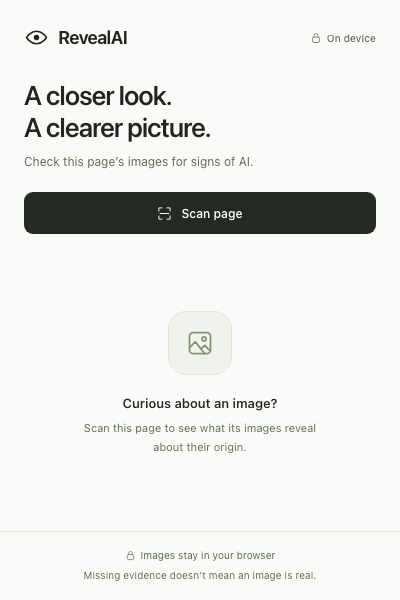

# RevealAI

A compact Chrome extension for a quick look at image origin information.
Scan a page, filter the results, and expand an image to see the evidence.
Checks run locally using the official C2PA WebAssembly reader.

## Run it

Use Node.js 22.12 or newer and npm.

```sh
npm ci
npm run build
```

Open `chrome://extensions`, enable Developer mode, choose **Load unpacked**, and select this repository's `dist` directory.
Open a regular website and click RevealAI's toolbar icon, then **Scan page**.
After rebuilding, reload the extension on the extensions page.

`npm run dev` runs Vite for development.
Browser-only previews cannot access Chrome extension APIs, so test actual page scans using the installed extension.

## What the results mean

| Result | Meaning |
| --- | --- |
| **AI indicated** | A trusted, valid credential bound to the image explicitly declares AI generation, editing, or a directly declared AI ingredient. |
| **Unknown** | Available provenance does not establish whether AI was used, including absent credentials, camera declarations, and untrusted signatures. |
| **Could not check** | The image could not be fetched, parsed, or checked within the resource limits. |

This release checks Content Credentials; it does not run a pixel-based AI classifier or a SynthID watermark detector.
An image without credentials may still be AI-generated.
A signed camera image is not proof that no AI was used or that the depicted event happened.
AI declarations describe the signer's assertions, with signature, signer trust, and image binding checked separately.
The extension does not invent confidence percentages for metadata.

Only active-image declarations and relevant direct ingredient source declarations affect the AI verdict.
Referenced ingredient history is treated conservatively when its evidence cannot be established independently.
Remote manifests and live certificate revocation lookups are disabled.
The result details disclose offline validation, and the [bundled trust-list notes](public/trust/README.md) document the roots, retrieval date, hashes, and refresh procedure.

## Privacy and limits

- Scans start only when you select **Scan page**.
- Analysis happens in a packaged local worker; image bytes are fetched from their original servers.
- RevealAI does not upload page images to a detector service.
- Images are discovered in the top-level document; frames and CSS background images are not scanned.
- Loaded images must be at least 50 × 50 pixels.
- Responsive image sources are respected and duplicates are checked once.
- Each scan checks up to 100 unique images and discloses when that limit is reached.
- Up to four image downloads run concurrently; native credential parsing runs serially to bound memory.
- Fetches time out after 15 seconds, accept at most 12 MiB, omit credentials and referrer headers, and surface failures individually.
- A pending credential check has a 20-second deadline; a stalled reader is terminated.
- Results last for the current popup session; closing it cancels the scan.
- Chrome internal pages, inaccessible tabs, unsupported image formats, and page-local blob/data URLs may be unavailable.

The broad HTTP(S) host permission lets the background worker fetch cross-origin images from the page.
There are no persistent content scripts.
The active page is inspected through an on-demand Chrome scripting call.
Opening an original image or the external SynthID checker is a separate user action.

## New detection integrations researched

Research checked October 22, 2026.

| Method | Fit for RevealAI | Integration path |
| --- | --- | --- |
| [C2PA](https://github.com/contentauth/c2pa-js) | Local, structured provenance evidence | Implemented using pinned `@contentauth/c2pa-wasm`, packaged worker/WASM, and the official C2PA trust lists. |
| [Sightengine](https://sightengine.com/docs/ai-generated-image-detection) | Pixel classification when metadata is absent | Evaluate `genai` on representative images, then use an authenticated backend holding the provider secret. |
| [Hive](https://docs.thehive.ai/reference/ai-generated-image-and-video-detection-1) | Alternative pixel classifier with source classification | Compare against the same samples before choosing a vendor. |
| [SynthID](https://blog.google/innovation-and-ai/models-and-research/google-deepmind/synth-id-ai-content/) | Watermarks from Google and supported partners | Manual checker link is implemented; the official material reviewed does not document a public image-detection API. |
| [Community Forensics](https://github.com/JeongsooP/Community-Forensics), [SAFE](https://github.com/Ouxiang-Li/SAFE) | Self-hosted detector candidates | Evaluate pretrained checkpoints, latency, domain accuracy, and code/model/data licenses before deployment. |
| [OmniAID](https://github.com/yunncheng/OmniAID), [PROBE](https://github.com/Amamiya-C/PROBE-AIGI-Detection) | Relevant 2026 research | Evaluate released artifacts; publication recency alone does not establish production suitability. |

Google opened SynthID Detector globally in English on October 7, 2026, with support announced for Google, OpenAI, NVIDIA, and Kakao, and Apple coming later.
It checks compatible watermarks, so a negative result does not prove an image is real.

Sightengine currently lists a free testing plan and a Starter plan at US$29/month for 10,000 operations, with overage charges; confirm current limits before subscribing.
See [official pricing](https://sightengine.com/pricing).

The recommended next experiment is a selected-image Sightengine check, compared with Hive on a held-out dataset containing current generators, compressed images, screenshots, crops, illustrations, and real edited photos.
Keep provenance, watermark evidence, and classifier scores separate, and treat conflicts as inconclusive.
A [February 2026 benchmark](https://arxiv.org/abs/2602.07814) found no universal winner across pretrained detectors and datasets.

For a cloud integration, keep the key on a server, require explicit image submission, validate uploads, authenticate and rate-limit requests, and avoid logging images or signed source URLs.
Calibrate thresholds before displaying **Likely AI** or **Likely not AI**.
Until then, present a model score as a model score and preserve the unknown verdict.

## Verify

```sh
npm test
npm run lint
npx playwright install chromium
npm run test:e2e
```

The browser suite loads the production extension in Chromium against controlled HTTP pages.
The cryptographic tests use the actual WASM reader, a signed test fixture, isolated test trust roots, and modified image bytes.
Test roots are not included in production trust lists.
See [fixture provenance](tests/fixtures/README.md).


